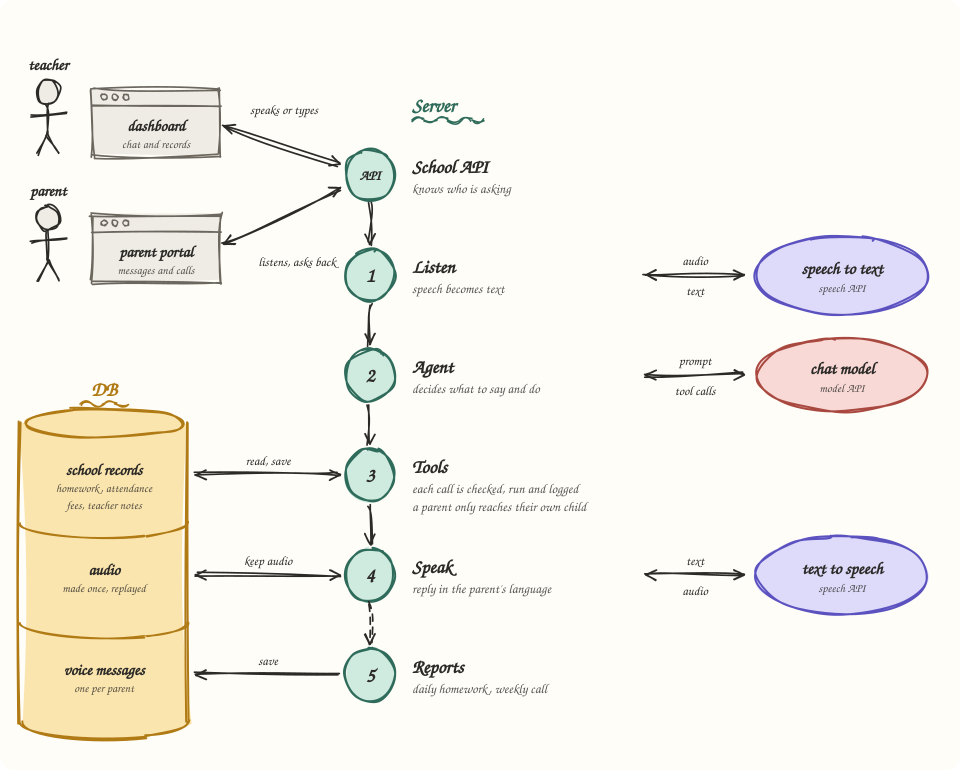

# Ghanti

A school voice agent. Teachers run the class by talking, and parents hear about
their child in their own language and can ask anything back.

My entry for Gnani AI's Great Indian AI Internship Challenge, built on Gnani's
Prisma (speech to text) and Timbre (text to speech).

Try it: https://ghanti-agent.vercel.app. No password, and every student and
parent in it is made up.

## Architecture



Speech to text is Gnani's Prisma and text to speech is Gnani's Timbre. The
website stands in for the phone call a parent would really get.

## How the agent works

The main idea is tool calling through a small harness: the model asks for a
tool, a dispatcher validates and runs it, the result goes back, and the model
answers. Teachers get write tools (homework, attendance, notes, fees), parents
get read tools scoped to their own child. That's `AGENT_MODE=tools`.

This runs on Gemini's free quota, though, and a tool loop is two or more
requests per turn. At 15 requests a minute the limit was hit all the time. So
the default is `AGENT_MODE=single`: one request per turn. The records the read
tools would have fetched go into the prompt, the model replies with JSON saying
what to say and which write tools to run, and the same dispatcher runs them.
Same tools, same guardrails, half the requests. With a paid key, switch back.

## Run it

Backend:

```bash
cd api
uv venv --python 3.12 && uv pip install -r requirements.txt
cp .env.example .env    # add your keys
.venv/bin/uvicorn main:app --reload --port 8000
```

Frontend, in another terminal:

```bash
cd web
npm install
npm run dev
```

Open http://localhost:3000 and pick a demo account.

It starts with `SPEECH_MODE=mock`, which spends no Gnani credits: the Chat tab
gets a menu of sample lines to send, and replies play a beep. Set
`SPEECH_MODE=gnani` in `api/.env` for real speech.

The teacher's Chat is voice only. Anything typed goes through the + Add buttons
on the Homework, Students and Fees tabs.

Tests: `cd api && .venv/bin/python -m pytest`

## Deploying

Two Vercel projects from one repo: `api/` (FastAPI, with `api/vercel.json` for
the region, time limit and the daily job) and `web/` (Next.js, with `API_URL`
set to the backend's address). The backend needs `DATABASE_URL` for Postgres,
both API keys, `SESSION_SECRET`, `CRON_SECRET` and `SPEECH_MODE=gnani`.

## Where things are

- `api/ghanti/agent/`: both agent modes (`loop.py`), the tool registry, and the teacher and parent tools
- `api/ghanti/llm/`: the LLM gateway and the Gemini adapter (tries `GEMINI_MODELS` in order)
- `api/ghanti/speech/`: Gnani and mock speech adapters
- `api/ghanti/routes/`: the HTTP API
- `web/app/teacher/`: the Chat tab and the dashboard tabs
- `web/app/parent/`: the parent portal and the call screen

## Docs

- [PLAN.md](PLAN.md): what it does, how it's built, what's left
- [API.md](API.md): Gnani's models and endpoints, with what we measured
